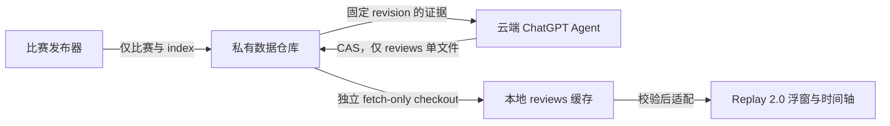

# 云端复盘协议与权限边界 V1

实现状态：P0 隔离候选，未部署。本文先说明数据流与存储契约，再给权限和一致性规则，最后列兼容、故障与操作限制。

## 文件和 Schema

- 数据文件唯一位置：`reviews/<match-id>/game-<N>.json`。match-id 是 1–120 位字母、数字、下划线、连字符，首位为字母或数字；局数 1–999，无前导零。路径大小写、扩展名和目录层级必须完全匹配。
- [JSON Schema](../schemas/MTGA_AI_REVIEW_V1.schema.json) 是结构契约；[TS 类型](../src/review/cloud-review-types.ts) 供调用方使用；JS 校验器直接读取同一 Schema，不联网解析 schema，不新增依赖。
- [ready](../examples/cloud-review/ready.json) 是完整合成报告；[missing](../examples/cloud-review/missing.json) 和 [stale](../examples/cloud-review/stale.json) 是传输状态样例。后两者**不是**合法可写 review 文件。无报告时不生成占位文件，过期报告保留原字节。
- 报告上限 128 KiB、24 notes、256 个 inspected 点、8 个英文牌名/条；拒绝额外字段、重复 JSON key、非法 UTF-8、过深对象、凭据、内部账号字段、机器路径及隐藏手牌结构。中文观察/建议/依据/限制不可缺省；自由文本的策略事实仍需审查，结构检查不能证明模型推理正确。

必填内容：`schema=MTGA_AI_REVIEW_V1`、match/game、`source_content_hash`、`policy_version`、`generated_at`、generator、provenance、coverage、summary、notes。当前 policy 为 `cloud-visible/1`。未知政策可保留于 Git 历史，但本地判为 stale，不显示标记。

source_content_hash 是比赛 index 条目的 content_hash，必须等于该比赛 manifest 的 content_hash；不是本地 review 指纹，也不是 report 自身哈希。manifest.files 的规范 JSON 的 SHA-256 构成比赛 content_hash，每个文件的原始字节再与 manifest SHA-256/bytes 对照。review 本身由 Git blob OID 和写入 receipt 的独立 SHA-256 标识，不加入比赛 manifest 或改变 index。

## 可验证路径与写权限分开

| 主体/接口 | 允许 | 禁止 |
| --- | --- | --- |
| 仓库历史校验 allowedPath | 原有数据路径 + 精确 review JSON | 任意其他 review 文件、symlink、gitlink、可执行 review、隐私或恶意历史 |
| 本地比赛发布器 isCoachSyncPath | 原有 matches/latest/index/README/gitignore | reviews、collection |
| 本地收藏发布器 isCollectionSyncPath | 原有 collection | reviews、比赛/index |
| 云端 prepareCloudReviewWrite/publishCloudReview | 一个精确 review 文件、一个预期 head 和原 blob | 源比赛、index、收藏、历史 Notes、强制推送、自动冲突重试 |
| 本地 review-sync | 私有目标核查、fetch、检查 Git 对象、读指定文件、写独立缓存 | checkout/merge/commit/push、写上传工作树或源数据库、浏览器接收 GitHub token |

全历史路径和 author/committer 检查保留；合法 review 可随远端提交被本地 fetch、fast-forward，之后正常比赛上传不触碰它。`.gitignore` 的 review 例外只是让远端合法文件可见，不赋予任何发布器写权限。语义验证缓存对 review 包含完整路径，防止相同 blob 被复制到另一 match/game 后继承校验结果。其他远端分支上的非法文件仍会使 `rev-list --all` 检查失败，不用分支绕过安全策略。

GitHub Contents write 是仓库级权限，不能宣传为目录 ACL。本轮的单文件范围由受限适配器和代码/操作契约执行，尚未给真实 Agent 配置新权限。真实试点仍需用户明确批准。

## 源、局数与动作边界

readPublishedReviewSource 只接受同一固定 revision 的内存文件集合：验证唯一 index 条目、manifest、全部声明文件/parts 及哈希；限制文件 2 MiB、总输入 128 MiB、最多 512 parts。使用已有 lossless codec 解析引用，限制展开深度 80、节点 800 万、字符串 64 MiB；缺失、畸形、循环或跨比赛引用失败关闭。早期 100 万节点限额被真实回放证明不足，已调大为仍然有界的上限。

每局独立确定 game_number；同局 anchor 必须唯一存在，所选 before/after 必须确有观测局面，不使用最近帧。每个 note 必须列在 coverage.inspected 中，且英文牌名精确属于该边界当时可见的我方手牌/公共区域。对手隐藏手牌不能成为证据；全局 cards 字典或后来公开的牌也不能反推此前知识。

coverage.actions_total 和 states_resolved 与该局源字典计数一致。sampled 仅声明所列点；all_actions 必须实际覆盖每个动作，当前最多 256 个检查点，因此长比赛通常必须用 sampled。整局总结可使用结果，决策 note 必须只依赖该时点知识。

## 本地读取与兼容

- `GET /api/matches/:id/review?game=N`：missing、ready、stale、syncing、error。返回适配后的 #4 展示结构，保留浮窗、英语标签、摘要和标记；未经证明的 critical/major 仍降为策略提示。
- `POST .../review/sync?game=N`：同源、`X-MTGA-Replay-Action: review-sync`、空 body、唯一合法 game 参数；202 启动只读同步。轮询/失联恢复只 GET。
- 原 `review/generate` 和 `review/cancel` 返回 410。Replay server 不 import 生成器，不读取模型密钥；即使旧调用者传 reviewGenerator 也不执行。原生成器/任务模块仅为历史代码和离线测试保留。
- 下载使用独立 `review-sync/repository` 与 `fetch.lock`；比赛上传仍使用原 coach-sync 工作树/锁。没有共享 Git index 或 checkout。
- 独立 `reviews.sqlite3/cloud_review_cache` 以 repo/branch/match/game 为键；cloud_review_targets 记录最后验证的分支。私有仓库身份与分支的发现和持久化在同一 fetch lease 内、解析不可信报告之前完成，防止非法新分支报告或晚到的旧任务回拨目标。
- 首次缓存要求当前本地输入通过现有 bundle builder 重现源 content_hash。缓存读取和发布前再核对整份本地输入指纹，包括牌表、起手牌、所有局、比赛元数据和 Notes；不只比较当前局 states。
- 离线保留上次通过的报告和原 checked_at，返回 offline/error 信息；不是“刚同步成功”。源 hash、完整输入或政策变化返回 stale。源数据库、原 Coach Notes 和收藏不迁移、不重写。

缓存是本机私有数据，旧一期 sidecar 表保持不变，但没有发布 hash 的旧报告不被冒充为 V1 云端报告。仅修改本轮隔离源码和缓存，原桌面版本未替换。

## 仍需后续验收

本轮实际写入只发生于临时 bare Git remote；云端真实 GitHub 连接的权限、身份、CAS 支持及提交回执尚未试点。大比赛整份源验证和首次本地重建存在 CPU/内存开销，尚无生产 UI 响应性指标；正式部署前应使用已有 compute worker 边界进一步验证，而不是取消校验。进程中断保留未知 fetch.lock，不自动判死或删除；目前需核查无运行进程后人工恢复隔离 reader。
